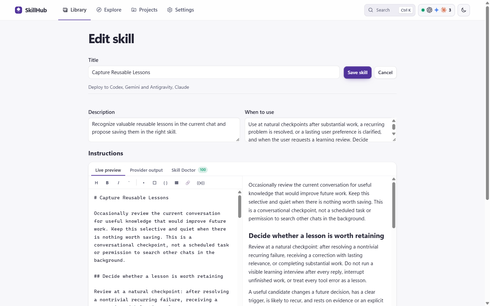
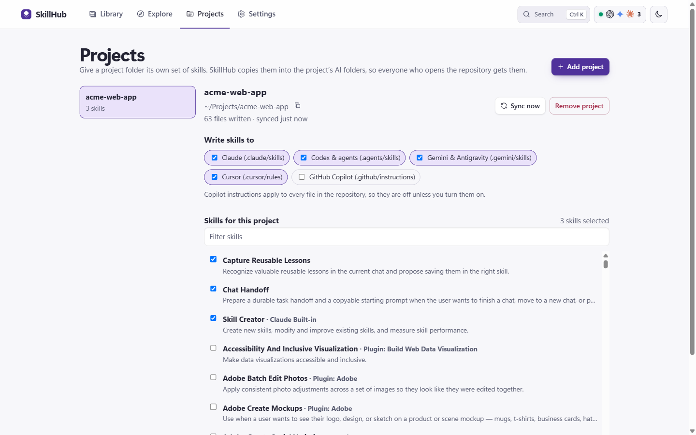
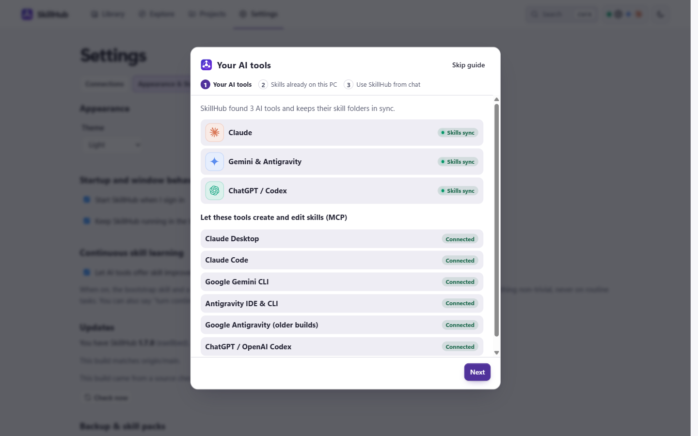
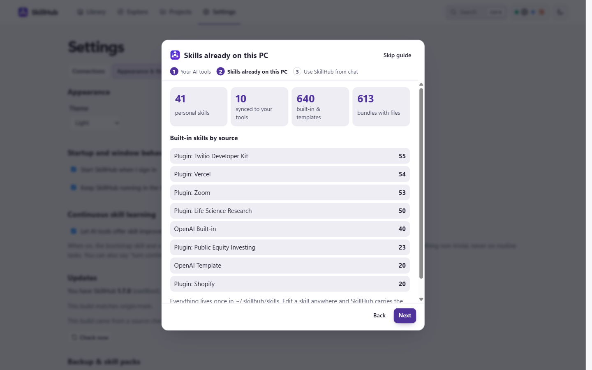

<div align="center">


# SkillHub

**One library of AI agent skills, kept in sync across every AI tool on your PC.**

Write a skill once. SkillHub turns it into the exact format Claude, Codex, Gemini and Antigravity expect (with experimental adapters for Cursor, Copilot, Windsurf, Cline and Roo Code), keeps every copy current in both directions, and lets your AI assistants search, preview and create skills for you over MCP.

Windows 11 · .NET 8 · native desktop app with a tray icon · local-first, no account, no cloud


</div>

---

## Why SkillHub

AI tools now share one idea, the `SKILL.md` skill folder, but each keeps its own copy in its own place and format. Edit a skill in Claude and Codex never hears about it; copy it by hand and the two drift apart. SkillHub fixes that with five pieces that work together:

| | |
|---|---|
| **Two-way sync** | Edit a skill in SkillHub *or* inside any AI tool's folder. A debounced file watcher picks up the change and carries it everywhere else within a second. |
| **Safe ownership ledger** | SkillHub records the hash of every file it writes. It only overwrites or deletes copies that still match, so an edit you made inside a tool is never lost: it becomes a review with a side-by-side diff and a safety backup. |
| **Multi-provider transpiler** | One canonical skill, many outputs: Claude frontmatter with `allowed-tools`, Gemini's single-line description, Codex's short summary, Cursor `.mdc` rules with globs. Merges are non-destructive, so metadata one tool cannot express survives a round trip through it. |
| **MCP authoring and prompts** | A local MCP server lets any connected assistant list, create, update, tag and import skills, search the ecosystem, and use every skill as a prompt (`/skillhub:<name>`) or resource (`skillhub://skills/<name>`). |
| **skills.sh and GitHub indexer** | Explore searches the skills.sh directory, curated repositories and any GitHub repository you paste. Every skill shows whether it is one file or a bundle, and scripts are reviewed before anything is imported. |

## A tour

<table>
<tr>
<td width="50%"><br><b>Explore</b>: skills.sh and GitHub in one search. The preview lists every bundle file and flags executable content before import.</td>
<td width="50%"><br><b>Editor 2.0</b>: Markdown toolbar, live preview, the exact output each tool receives, and Skill Doctor checks for provider limits, broken links, secrets and risky scripts.</td>
</tr>
<tr>
<td width="50%"><br><b>Projects</b>: give a repository its own skill set. SkillHub writes it into the project's <code>.claude</code>, <code>.agents</code>, <code>.gemini</code> and <code>.cursor</code> folders (optionally <code>.github/skills</code> and others), keeps it current and, by default, out of Git.</td>
<td width="50%"><br><b>Connections</b>: every detected tool, its skills folder and its MCP connection, with one-click connect and re-apply.</td>
</tr>
<tr>
<td width="50%"><br><b>Welcome guide</b>: on first launch, see which AI tools were found and connect them in one click.</td>
<td width="50%"><br>…then what is already on disk: personal skills, built-ins from OpenAI, Anthropic and Google, and bundles.</td>
</tr>
</table>

## Supported AI tools

SkillHub's adapters fall into two tiers. Please read them as what they are.

### Tier 1: live-verified on Windows 11

Checked against the installed tools on the maintainer's Windows 11 PC: SkillHub detected each tool, wrote its skills and MCP entry to the listed paths, and the files were confirmed on disk. Codex, Antigravity CLI and Claude Code (including the Code tab in Claude Desktop) were seen loading the synced skills. Antigravity IDE's global folder (`~/.gemini/config/`) was added in 1.3 from Antigravity's own bundled documentation and confirmed on disk.

| Tool | Global skills folder | MCP connection | Project folder |
|---|---|---|---|
| ChatGPT / OpenAI Codex | `~/.codex/skills`, `~/.agents/skills` | Automatic: `~/.codex/config.toml` | `.agents/skills` |
| Gemini CLI | `~/.gemini/skills` | Automatic: `~/.gemini/settings.json` | `.gemini/skills` |
| Google Antigravity (CLI & IDE) | `~/.gemini/config/skills`, the global customization root both read; `~/.gemini/antigravity/skills` for older builds | Automatic: `~/.gemini/config/mcp_config.json` (and `~/.gemini/antigravity/mcp_config.json` for older builds) | `.agents/skills` |
| Claude Code | `~/.claude/skills`, `~/.claude/commands` | Automatic: `~/.claude.json` | `.claude/skills` |
| Claude Desktop (Microsoft Store & standard) | The Code tab reads `~/.claude/skills`. The chat **Skills** screen shows skills saved in your claude.ai account (see below) | Automatic: `claude_desktop_config.json` in the app's real data folder, including the Store app's `%LOCALAPPDATA%\Claude-Data\` | Uses Claude Code's `.claude/skills` |

Claude Desktop notes:

- **The chat Skills screen can't be filled from disk.** Claude downloads your account's skills into a local cache and deletes anything else it finds there. Connections explains this and prepares upload-ready ZIPs; upload a skill once in Claude › Settings › Capabilities › Skills to use it in chat. Anthropic's built-in skills from that cache are listed read-only under Built-in & Templates.
- **Close Claude before connecting.** Claude Desktop rewrites its config while it runs, which can drop a newly added MCP entry. *Restart Claude to apply* in Connections closes Claude, writes and checks the entry, and starts Claude again. This button is covered by automated tests; it was not clicked on the maintainer's PC, because that session ran inside Claude Desktop.

### Tier 2: experimental, tested against documented paths and fixtures

These adapters follow each tool's public documentation and are covered by automated tests against fixture folders. **They were not live-tested against an installed copy of the tool.** Feedback and corrections are welcome.

| Tool | Global folder SkillHub writes | MCP connection | Project folder (Projects tab) |
|---|---|---|---|
| Cursor | `~/.cursor/rules/<name>.mdc`. Cursor documents user-level skills in `~/.cursor/skills` and also reads `~/.claude/skills` and `~/.codex/skills`, which SkillHub already fills, so expect Cursor to find your skills there. | Automatic: `~/.cursor/mcp.json` | `.cursor/rules/<name>.mdc` |
| GitHub Copilot | `~/.copilot/skills` (personal skills; documented for the Copilot coding agent and CLI, and for VS Code) | Manual: add the command `SkillHub.exe` with the argument `mcp-stdio` to VS Code's `mcp.json` or the Copilot CLI settings | `.github/skills` (opt-in) |
| Windsurf | `~/.codeium/windsurf/skills` | Automatic: `~/.codeium/windsurf/mcp_config.json` (Claude Desktop schema per Windsurf's docs) | `.windsurf/skills` (opt-in) |
| Cline | `Documents\Cline\Rules\<name>.md`, opt-in per skill | Manual: Cline keeps MCP servers in its VS Code extension storage (MCP Servers › Configure) | `.clinerules/<name>.md` (opt-in) |
| Roo Code | `~/.roo/rules/<name>.md`, opt-in per skill | Manual: Roo keeps global MCP servers in its VS Code extension storage (Edit Global MCP) | `.roo/rules/<name>.md` (opt-in) |

Cline and Roo Code load every rule into every conversation, so skills reach them only when you turn them on per skill or per project. SkillHub does not write Cline's or Roo's MCP settings because their location depends on the VS Code variant and extension storage, which SkillHub could not verify.

## Quick start

1. **Install.** Download `SkillHub-Setup.exe` from the [latest release](https://github.com/KamilTahiri/SkillHub/releases/latest) (or build it, below) and run it. It installs per user into `%LOCALAPPDATA%\SkillHub`, adds a Start Menu shortcut, and needs the Microsoft Edge WebView2 Runtime (already present on Windows 11).
2. **Follow the welcome guide.** It shows the AI tools SkillHub found and connects their MCP settings in one click. Restart each tool you connected.
3. **Ask your assistant.** In any connected tool, try:

   > Use SkillHub to find or create a skill for writing Playwright tests in this project.

   > Use SkillHub to search skills.sh and GitHub for skills that fit this repository, preview the best three, and tell me which to import.

### Build from source

Requirements: .NET 8 SDK, Inno Setup 6.7.4 (set `SKILLHUB_ISCC` if it is not on `PATH`), and Node.js 22+ with Chrome or Edge for the UI tests.

```powershell
dotnet test SkillSync.sln                 # engine, transpilers, sync safety, HTTP contracts, MCP
node --test "tests/SkillSync.Frontend/*.test.mjs"     # headless Chromium UI harness
.\install.ps1                             # build the installer, install for this user, verify every file, launch
```

`build-installer.ps1` alone produces `dist/SkillHub-Setup.exe` and its SHA-256 checksum. Pass `-SignCommand` (or set `SKILLHUB_SETUP_SIGN_COMMAND`) to sign setup and the uninstaller.

## Features

- **Library**: My Skills, Active & Synced, Built-in & Templates (OpenAI, Anthropic and Antigravity built-ins found on disk) and System, with tags, filters, instruction search and a Ctrl+K command palette.
- **History**: 30 revisions per skill with diff and one-click restore. **Update inbox** for imported skills when their upstream changes.
- **Context budget meter**: the Library header shows how many tokens of skill descriptions every chat receives from globally synced skills (*Always-loaded: ~1.6k tokens / chat*), with a breakdown by source and a warning before tools such as Claude Code start dropping descriptions.
- **Scope: Global, Project-only or Off**: every skill has a scope. Project-only skills cost nothing in other chats and appear only in projects that choose them. Bulk actions move a whole pack (by source repository or tag) or a multi-selection in one click; assistants use `set_skill_scope`.
- **Projects**: per-project skill sets written into a repository's own AI folders (`.claude/skills`, `.agents/skills`, `.gemini/skills`, `.cursor/rules`, and opt-in `.github/skills`, `.windsurf/skills`, `.clinerules`, `.roo/rules`). Skills that are also global are flagged *Also global — redundant here* with a one-click switch to Project-only, and *Keep local* (on by default in Git repositories) lists the generated folders in `.git/info/exclude`. Edits you make inside the project are never overwritten. From chat: `create_project`, `inspect_project_skills` (what reaches the tools in a folder, including skills inherited from a parent project, as metadata only), `list_projects` and `set_project_skills` ("use the Roblox pack in this repo"). One skill can serve many projects; removing it from one never touches the others.
- **Umbrella folders**: for a folder that groups several projects (such as `Roblox Games\`), add it once and tick *Umbrella folder (sync into each direct subfolder)*, or pass `umbrella: true` to `create_project` / `set_project_skills`. SkillHub writes the skills into every direct subfolder (and each child repository's `.git/info/exclude`), never into the umbrella folder itself, skips hidden and tooling folders such as `.git`, `node_modules` and `.vs`, and deploys to new subfolders as soon as they appear. IDE tools that stop at a game's own `.git` therefore still see the pack. The Projects tab and `inspect_project_skills` list the detected subfolders.
- **Tag hygiene from chat**: `list_tags` returns tags, per-skill tags and hygiene issues (untagged skills, near-duplicates such as `3d` / `3d-modeling`, single-use tags) without reading any skill bodies; `manage_tags` adds, removes, renames, merges and deletes tags in batch, keeping History.
- **Library audit and trigger tester**: *Run Library Audit* (or `lint_library`) runs Skill Doctor on every skill and adds trigger collisions between skills, references to companion skills you have not installed, descriptions over 1,024 characters and the budget. *Test triggers* (Ctrl+K, or `test_skill_trigger`) ranks which skills a sample prompt would load and flags ties.
- **Skill packs**: export one skill, a selection, or a full backup as `.skillpack.zip` (each `SKILL.md`, every companion file and a `skillpack.json` manifest). Import reviews name conflicts and scripts before anything is written.
- **Diagnostics in plain language**: the folders being watched, *Verify & Sync All Folders*, conflict and safety backups with compare / restore, and a readable activity log.
- **Self-update**: SkillHub checks GitHub Releases (or `origin/main` on a source checkout) and shows *Update & Restart* in the top bar and Settings. It verifies the installer's SHA-256 before running it. Assistants can do the same through MCP (`check_skillhub_update`, `apply_skillhub_update`).
- **skills.sh synergy**: paste `npx skills add owner/repo --skill name` (or a `skills.sh/owner/repo/name` link) into the Explore search or *Import from URL / File* and SkillHub opens that skill's preview. Community and imported skills have *Copy npx skills add*, and skills already installed with `npx skills add` are linked to their upstream repository from the CLI's lock file when SkillHub adopts them.
- **Descriptions that trigger, not summarize**: Skill Doctor (`lint_skill`, `lint_library`) warns when a skill with strict guardrails (`never`, `must`, `only if`) has a description that summarizes the rules instead of saying when to use the skill and that the AI must read the full `SKILL.md` first. The bootstrap skill, shown in My Skills with a *Built-in* badge and its token cost, teaches assistants the same rule.
- **Hands-free imports**: community skills sync to your detected AI tools by default. Explore and MCP show GitHub stars and skills.sh installs, and a skill that ships scripts asks once ("Confirm, Import & Sync Now", or `confirm_scripts: true` from chat).
- **Continuous skill learning** (on by default, toggle in Settings or with `set_skillhub_preferences`): your AI tools offer to improve a skill you wrote only after solving something non-trivial, and save ideas for later with `propose_skill_improvement`. Imported community skills never get the learning note, so their upstream updates stay clean.
- **Explore**: sticky result counts, infinite scroll, `1 file (SKILL.md)` versus `📦 Bundle · N files` on every row, and per-skill imports or batch imports.

## MCP tools

Connected assistants get 34 tools: `list_skills`, `get_skill`, `create_skill`, `update_skill`, `delete_skill`, `manage_skill_tags`, `toggle_skill_provider`, `lint_skill`, `get_sync_status`, `restore_skill`, `activate_catalog_skill`, `clone_catalog_skill`, `search_community_skills` (skills.sh, curated and pinned repositories, the offline catalog, or any `owner/repo`), `browse_community_repo`, `preview_community_skill` (full `SKILL.md`, bundle manifest, script review and companion files), `prepare_skill_import`, `apply_skill_import`, `import_community_skill`, `check_skillhub_update`, `apply_skillhub_update`, `set_skillhub_preferences`, `propose_skill_improvement`, `list_skill_proposals`, `apply_skill_proposal`, `lint_library`, `get_context_budget`, `set_skill_scope`, `test_skill_trigger`, `list_tags`, `manage_tags`, `list_projects`, `create_project`, `inspect_project_skills` and `set_project_skills`. Every skill is also an MCP prompt and resource. The seeded `00-skillhub-bootstrap` skill teaches assistants to use these tools instead of copying files between tools.

## Architecture

```text
 AI tools (Claude, Codex, Gemini, Antigravity, Cursor, Copilot, …)
        │  read/write their own folders            │  MCP over stdio
        ▼                                            ▼
 MultiRootFileWatcher ──► SyncEngine ◄── SkillHub.exe mcp-stdio ──named pipe──► McpJsonRpcHandler
   (debounced saves,        │   ▲                                                 (34 tools, prompts,
    ignores *.skillsync-tmp)│   │ transpilers: Canonical · Claude · Gemini ·       resources)
                            │   │ Codex · Cursor .mdc · Agent skill · Plain rule
                            ▼   │
             ~/.skillhub/skills/<name>/  ← single source of truth (SKILL.md + bundle files)
             ~/.skillhub/sync-ledger.json, history/, conflicts/, trash/, workspaces/
                            ▲
 WinForms + WebView2 window ┘ REST API on 127.0.0.1 (desktop session token) · vanilla ES module UI
```

Loop prevention has three layers: a pre-registered hash of every file SkillHub writes, semantic hash comparison so formatting changes never trigger writes, and per-skill debouncing that ignores temporary files. There is no database: skills, the ledger, history, backups and workspaces are plain files under `~/.skillhub`.

```text
src/SkillSync.Daemon/   desktop host, REST API, MCP server, watcher, engine (Core/), UI (wwwroot/)
src/SkillHub.Core/      the portable engine as a net8.0 library
tests/                  xUnit, the Chromium UI harness, live checks against the running app (tests/live/)
installer/              Inno Setup script
```

## Privacy and local access

- Skills and sync state stay in your user profile. Explore contacts GitHub and skills.sh only when you browse, search or import.
- Installed AI clients use `SkillHub.exe mcp-stdio`, which talks to the current user's named pipe. HTTP MCP is off unless you set `SKILLHUB_HTTP_MCP_TOKEN` (32+ characters); it is loopback-only and requires a bearer token.
- Every config file SkillHub edits is backed up first. Deleted skills go to `~/.skillhub/trash/` and can be restored from Diagnostics or with `restore_skill`.
- Uninstalling keeps your skills, backups and WebView data. Disconnect clients and turn off login startup in Settings first if you want those removed too.

## Status

SkillHub is a Windows preview; [Releases](https://github.com/KamilTahiri/SkillHub/releases) lists the current version and its changes. Compatibility with a particular client depends on its configuration format; Settings shows the exact paths and registration state SkillHub uses.

See [LICENSE](LICENSE) (Apache 2.0), [third-party notices](THIRD_PARTY_NOTICES.md), [Contributing](CONTRIBUTING.md) and [Security](SECURITY.md).
