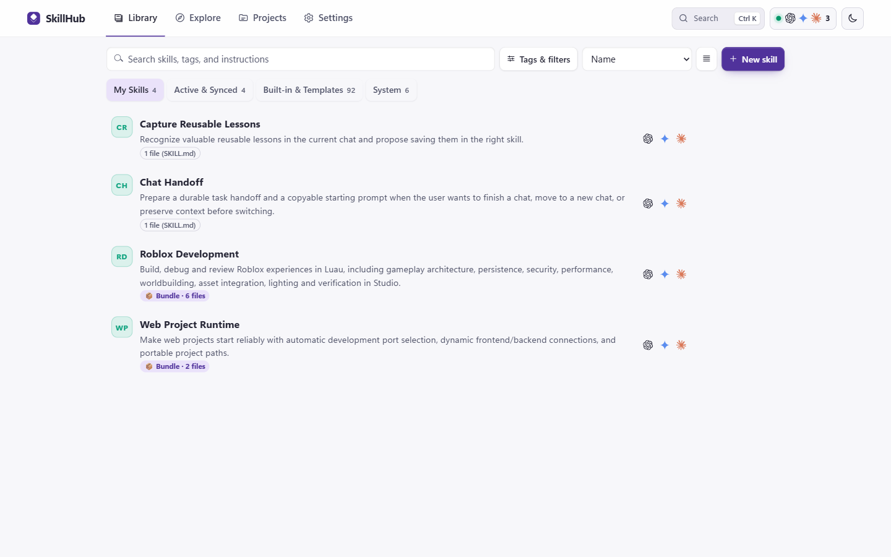
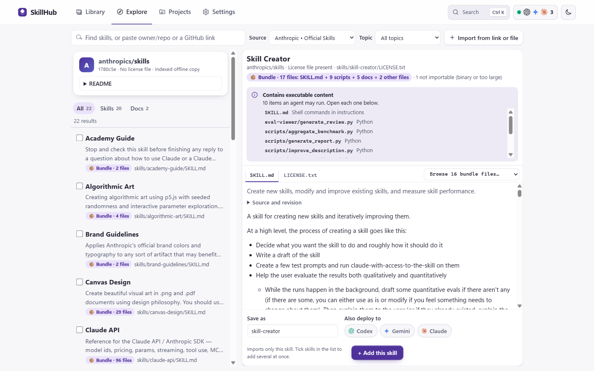
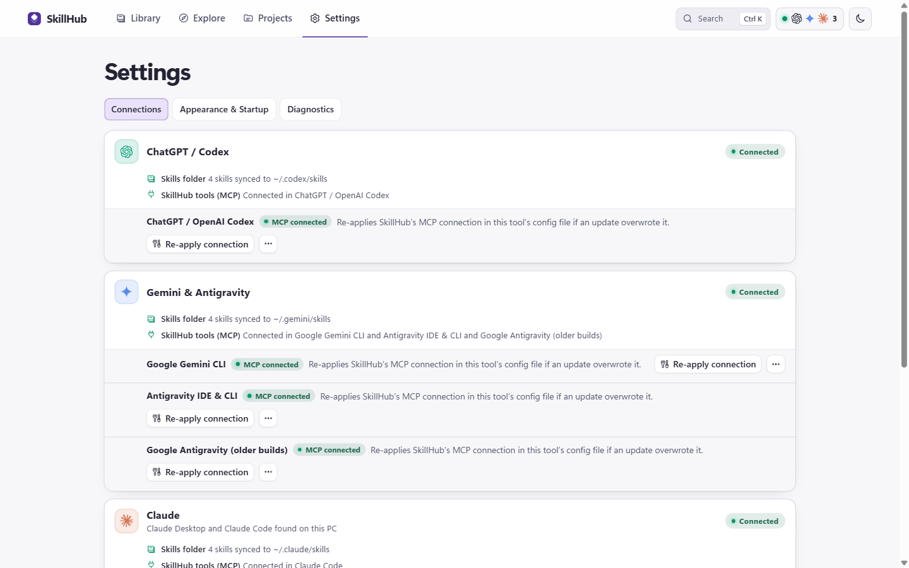

<div align="center">

# SkillHub

**One library of AI agent skills, kept in sync across every AI tool on your PC.**

Write a skill once. SkillHub turns it into the exact format Claude, Codex, Gemini, Antigravity, Cursor, Copilot, Windsurf, Cline and Roo Code expect, keeps every copy current in both directions, and lets your AI assistants search, preview and create skills for you over MCP.

Windows 11 · .NET 8 · native desktop app with a tray icon · local-first, no account, no cloud



</div>

---

## Why SkillHub

AI tools now share one idea, the `SKILL.md` skill folder, but each keeps its own copy in its own place and format. Edit a skill in Claude and Codex never hears about it; copy it by hand and the two drift apart. SkillHub fixes that with five pieces that work together:

| | |
|---|---|
| **Two-way sync** | Edit a skill in SkillHub *or* inside any AI tool's folder. A debounced file watcher picks up the change and carries it everywhere else within a second. |
| **Safe ownership ledger** | SkillHub records the hash of every file it writes. It only overwrites or deletes copies that still match, so an edit you made inside a tool is never lost: it becomes a review with a side-by-side diff and a safety backup. |
| **Multi-provider transpiler** | One canonical skill, many outputs: Claude frontmatter with `allowed-tools`, Gemini's single-line description, Codex's short summary, Cursor `.mdc` rules with globs. Merges are non-destructive, so metadata one tool cannot express survives a round trip through it. |
| **MCP authoring and prompts** | A local MCP server lets any connected assistant list, create, update, tag and import skills, search the ecosystem, and use every skill as a prompt (`/skillhub:<name>`) or resource (`skillhub://skills/<name>`). |
| **skills.sh and GitHub indexer** | Explore searches the skills.sh directory, curated repositories and any GitHub repository you paste. Every skill shows whether it is one file or a bundle, and scripts are reviewed before anything is imported. |

## A tour

<table>
<tr>
<td width="50%"><br><b>Explore</b>: skills.sh and GitHub in one search. The preview lists every bundle file and flags executable content before import.</td>
<td width="50%"><br><b>Editor 2.0</b>: Markdown toolbar, live preview, the exact output each tool receives, and Skill Doctor checks for provider limits, broken links, secrets and risky scripts.</td>
</tr>
<tr>
<td width="50%"><br><b>Projects</b>: give a repository its own skill set. SkillHub writes it into the project's <code>.claude</code>, <code>.agents</code>, <code>.gemini</code>, <code>.cursor</code> and <code>.github</code> folders and keeps it current.</td>
<td width="50%"><br><b>Connections</b>: every detected tool, its skills folder and its MCP connection, with one-click connect and re-apply.</td>
</tr>
<tr>
<td width="50%"><br><b>Welcome guide</b>: on first launch, see which AI tools were found and connect them in one click.</td>
<td width="50%"><br>…then what is already on disk: personal skills, built-ins from OpenAI, Anthropic and Google, and bundles.</td>
</tr>
</table>

## Supported AI tools

| Tool | Global skills folder | Format | Synced by default | MCP connection | Project folder |
|---|---|---|---|---|---|
| ChatGPT / OpenAI Codex | `~/.codex/skills`, `~/.agents/skills` | `SKILL.md` folder | Yes | Automatic (`~/.codex/config.toml`) | `.agents/skills` |
| Gemini CLI | `~/.gemini/skills` | `SKILL.md` folder | Yes | Automatic (`~/.gemini/settings.json`) | `.gemini/skills` |
| Google Antigravity IDE & CLI | `~/.gemini/config/skills` (global customizations), plus `~/.gemini/antigravity/skills` for older builds | `SKILL.md` folder | Yes | Automatic (`~/.gemini/config/mcp_config.json`) | `.gemini/skills` |
| Claude Code | `~/.claude/skills`, `~/.claude/commands` | `SKILL.md` folder | Yes | Automatic (`~/.claude.json`) | `.claude/skills` |
| Claude Desktop | Code tab: `~/.claude/skills`. Chat Skills screen: your claude.ai account (upload ZIPs from Connections) | `SKILL.md` folder | Code tab only | Automatic, including the Microsoft Store app; *Restart Claude to apply* closes and reopens Claude so it keeps the entry | n/a |
| Cursor | `~/.cursor/rules` | `.mdc` rule | Yes | Automatic (`~/.cursor/mcp.json`) | `.cursor/rules` |
| GitHub Copilot | `~/.copilot/skills` | `SKILL.md` folder | Yes | Add `SkillHub.exe mcp-stdio` yourself | `.github/instructions` (opt-in) |
| Windsurf | `~/.codeium/windsurf/skills` | `SKILL.md` folder | Yes | Add `SkillHub.exe mcp-stdio` yourself | n/a |
| Cline | `~/Documents/Cline/Rules` | `.md` rule | Opt-in per skill | Add `SkillHub.exe mcp-stdio` yourself | n/a |
| Roo Code | `~/.roo/rules` | `.md` rule | Opt-in per skill | Add `SkillHub.exe mcp-stdio` yourself | n/a |

Cline and Roo Code load every rule into every conversation, so skills reach them only when you turn them on. Claude Desktop's chat **Skills** screen lists skills saved in your claude.ai account: the app downloads them into a cache and removes anything else from it, so they cannot be synced from disk. SkillHub shows this in Connections, prepares upload-ready ZIPs, connects the MCP server, and lists Anthropic's built-in skills so you can copy them to other tools.

## Quick start

1. **Install.** Download `SkillHub-Setup.exe` from a release (or build it, below) and run it. It installs per user into `%LOCALAPPDATA%\SkillHub`, adds a Start Menu shortcut, and needs the Microsoft Edge WebView2 Runtime (already present on Windows 11).
2. **Follow the welcome guide.** It shows the AI tools SkillHub found and connects their MCP settings in one click. Restart each tool you connected.
3. **Ask your assistant.** In any connected tool, try:

   > Use SkillHub to find or create a skill for writing Playwright tests in this project.

   > Use SkillHub to search skills.sh and GitHub for skills that fit this repository, preview the best three, and tell me which to import.

### Build from source

Requirements: .NET 8 SDK, Inno Setup 6.7.4 (set `SKILLHUB_ISCC` if it is not on `PATH`), and Node.js 22+ with Chrome or Edge for the UI tests.

```powershell
dotnet test SkillSync.sln                 # engine, transpilers, sync safety, HTTP contracts, MCP
node --test tests/SkillSync.Frontend/     # headless Chromium UI harness
.\install.ps1                             # build the installer, install for this user, verify every file, launch
```

`build-installer.ps1` alone produces `dist/SkillHub-Setup.exe` and its SHA-256 checksum. Pass `-SignCommand` (or set `SKILLHUB_SETUP_SIGN_COMMAND`) to sign setup and the uninstaller.

## Features

- **Library**: My Skills, Active & Synced, Built-in & Templates (OpenAI, Anthropic and Antigravity built-ins found on disk) and System, with tags, filters, instruction search and a Ctrl+K command palette.
- **History**: 30 revisions per skill with diff and one-click restore. **Update inbox** for imported skills when their upstream changes.
- **Projects**: per-project skill sets written into a repository's own AI folders. Edits you make inside the project are never overwritten.
- **Skill packs**: export one skill, a selection, or a full backup as `.skillpack.zip` (each `SKILL.md`, every companion file and a `skillpack.json` manifest). Import reviews name conflicts and scripts before anything is written.
- **Diagnostics in plain language**: the folders being watched, *Verify & Sync All Folders*, conflict and safety backups with compare / restore, and a readable activity log.
- **Explore**: sticky result counts, infinite scroll, `1 file (SKILL.md)` versus `📦 Bundle · N files` on every row, and per-skill imports or batch imports.

## MCP tools

Connected assistants get 18 tools: `list_skills`, `get_skill`, `create_skill`, `update_skill`, `delete_skill`, `manage_skill_tags`, `toggle_skill_provider`, `lint_skill`, `get_sync_status`, `restore_skill`, `activate_catalog_skill`, `clone_catalog_skill`, `search_community_skills` (skills.sh, curated and pinned repositories, the offline catalog, or any `owner/repo`), `browse_community_repo`, `preview_community_skill` (full `SKILL.md`, bundle manifest, script review and companion files), `prepare_skill_import`, `apply_skill_import` and `import_community_skill`. Every skill is also an MCP prompt and resource. The seeded `00-skillhub-bootstrap` skill teaches assistants to use these tools instead of copying files between tools.

## Architecture

```text
 AI tools (Claude, Codex, Gemini, Antigravity, Cursor, Copilot, …)
        │  read/write their own folders            │  MCP over stdio
        ▼                                            ▼
 MultiRootFileWatcher ──► SyncEngine ◄── SkillHub.exe mcp-stdio ──named pipe──► McpJsonRpcHandler
   (debounced saves,        │   ▲                                                 (18 tools, prompts,
    ignores *.skillsync-tmp)│   │ transpilers: Canonical · Claude · Gemini ·       resources)
                            │   │ Codex · Cursor .mdc · Agent skill · Plain rule
                            ▼   │
             ~/.skillhub/skills/<name>/  ← single source of truth (SKILL.md + bundle files)
             ~/.skillhub/sync-ledger.json, history/, conflicts/, trash/, workspaces/
                            ▲
 WinForms + WebView2 window ┘ REST API on 127.0.0.1 (desktop session token) · vanilla ES module UI
```

Loop prevention has three layers: a pre-registered hash of every file SkillHub writes, semantic hash comparison so formatting changes never trigger writes, and per-skill debouncing that ignores temporary files. There is no database: skills, the ledger, history, backups and workspaces are plain files under `~/.skillhub`.

```text
src/SkillSync.Daemon/   desktop host, REST API, MCP server, watcher, engine (Core/), UI (wwwroot/)
src/SkillHub.Core/      the portable engine as a net8.0 library
tests/                  xUnit, the Chromium UI harness, live checks against the running app (tests/live/)
installer/              Inno Setup script
```

## Privacy and local access

- Skills and sync state stay in your user profile. Explore contacts GitHub and skills.sh only when you browse, search or import.
- Installed AI clients use `SkillHub.exe mcp-stdio`, which talks to the current user's named pipe. HTTP MCP is off unless you set `SKILLHUB_HTTP_MCP_TOKEN` (32+ characters); it is loopback-only and requires a bearer token.
- Every config file SkillHub edits is backed up first. Deleted skills go to `~/.skillhub/trash/` and can be restored from Diagnostics or with `restore_skill`.
- Uninstalling keeps your skills, backups and WebView data. Disconnect clients and turn off login startup in Settings first if you want those removed too.

## Status

SkillHub 1.3 is a Windows preview. Compatibility with a particular client depends on its configuration format; Settings shows the exact paths and registration state SkillHub uses.

See [LICENSE](LICENSE) (Apache 2.0), [third-party notices](THIRD_PARTY_NOTICES.md), [Contributing](CONTRIBUTING.md) and [Security](SECURITY.md).
